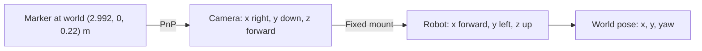
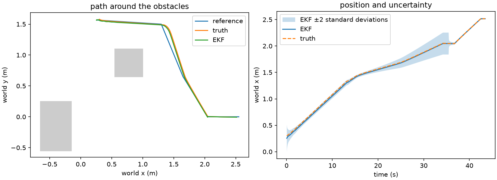

# TurtleBot fixed-route docking

41014 Integrated Project, Track A. The robot follows a fixed route through a MuJoCo room with
two known obstacles. Wheel encoders predict its pose, the camera corrects
it, and forward LiDAR can stop it if the route gets blocked.

| project detail | entry |
|---|---|
| group number | add before submission |
| members | rinoW1010 and Tom Kelsey, from the local Git history. Confirm the full names and roster before submission. |
| repository | [41014_IntegratedProject](https://github.com/rinoW1010/41014_IntegratedProject) |

## run it on Windows

Open PowerShell in this folder. Use Python 3.12 for the pinned requirements.

```powershell
py -3.12 -m venv .venv
.\.venv\Scripts\python.exe -m pip install -r requirements-lock.txt
.\.venv\Scripts\python.exe -m pytest -q
.\.venv\Scripts\python.exe check_stage5.py
.\.venv\Scripts\python.exe check_stage6.py
.\.venv\Scripts\python.exe check_block.py
.\.venv\Scripts\python.exe -m turtlebot_project.simple_run
.\.venv\Scripts\python.exe plot_trial.py outputs/nominal
.\.venv\Scripts\python.exe -m turtlebot_project.simple_run --varied
.\.venv\Scripts\python.exe plot_trial.py outputs/varied
```

Each run saves the reference, estimated pose, true pose and wheel-only pose
in `trial.csv`, plus whether it docked and the errors in `metrics.json`. The plot shows
the route and the estimated world x with its ±2 standard deviation band.
Use `--frames` with a fresh `--output` directory to save a frame sequence at
5 Hz. The earlier movement check still runs with `python run.py` inside the
environment.

## motion model

The state is `[x, y, yaw]`. the wheel radius is 0.033 m, track width is
0.160 m and the control and estimation step is 0.05 s. the inputs to the pose
prediction are measured left and right wheel displacements in metres.

```text
distance = (right + left) / 2
turn = (right - left) / track_width
x_next = x + distance * cos(yaw + turn/2)
y_next = y + distance * sin(yaw + turn/2)
yaw_next = wrap(yaw + turn)
```

We use the heading halfway through the step to work out which way the robot moved.
we assume the robot moves on a flat floor with a bit of wheel slip. MuJoCo handles the wheel contacts and the EKF allows for extra error from slip.

For along-track, cross-track and heading errors around a straight reference
moving at speed v, the small-error continuous model is:

```text
A = [[0, 0, 0],       B = [[1, 0],
     [0, 0, v],            [0, 0],
     [0, 0, 0]]            [0, 1]]
```

Changing speed helps fix how far ahead or behind the robot is. Turning changes heading, which
then changes cross-track error when v is nonzero. The columns of
`[B, AB, A²B]` span three directions at 0.08 m/s and two at standstill.

## frames and sensing



The marker's x, y and z axes point along world −y, +z and −x. The camera
origin is 0.060 m forward and 0.15 m up in the body frame. Its axes point
along body −y, −z and +x. The transform used in code is
`T_WB = T_WM @ inverse(T_CM) @ inverse(T_BC)`, where each transform maps
from its second frame to its first. The 640 × 480 image uses a 50° vertical
field of view, so the focal length is `480 / (2*tan(25°))` pixels. the
camera model uses zero distortion and a 0.24 m marker.

the EKF starts from the first camera pose. it predicts from measured wheel
motion and corrects with a full planar camera pose, so H is the identity
when a usable image is available. Encoders give increments and cannot
recover an unknown global pose on their own. The process model uses wheel
displacement standard deviation `0.0005 + 0.05*abs(displacement)` m and a
small covariance floor. Image pose standard deviations are
`0.04 + 0.015*range²` m in x and y and `3 + range` degrees in heading,
with range in metres. These are the noise values we set for the filter. The measured
camera errors are in [the results](RESULTS.md). A smaller measurement
covariance gives an accepted image more influence. The innovation gate
rejects values above 11.34.

## route and docking

The reference moves at 0.08 m/s. Position error in the robot frame changes
speed with a gain of 0.9 per second and turning with a gain of 2.8 rad/s per
metre of sideways error. heading error adds turning with a gain of 1.8 per
second. the limits are 0.12 m/s and 0.55 rad/s. the front LiDAR sector is
±25° and blocks forward motion under 0.23 m or when the readings are
unusable. The reference pauses while forward motion is blocked.

At the staging point the robot turns towards the marker. The final approach
requires accepted camera updates. To turn the simulated charge indicator
green, the estimated position and heading must stay within 0.04 m and 5°
of the dock with a zero motion command for one second. We check the final true pose separately when scoring the run. We use the same room and obstacle positions each time. The marker needs to be visible at the start.



## contributions and sources

The repository history records initial setup, motion, odometry and camera
checks under rinoW1010. Tom Kelsey's commits added the room configuration,
obstacles, random and repeatable starts, camera-pose EKF and feedback with
LiDAR safety. confirm the submission contribution statements with the team.

the project uses the supplied tutorials for motion, frames, sensing,
estimation and feedback. robot geometry and the simulation and vision APIs
were checked against the project sources. [ROBOTIS model](https://github.com/ROBOTIS-GIT/turtlebot3_simulations/blob/main/turtlebot3_gazebo/models/turtlebot3_burger/model.sdf) · [MuJoCo docs](https://mujoco.readthedocs.io/en/stable/python.html) · [OpenCV ArUco docs](https://docs.opencv.org/4.x/d5/dae/tutorial_aruco_detection.html)

OpenAI Codex helped review the brief and tutorials, generate and debug the
initial simulation, organise the stages, and implement and verify the final
fixed-route integration and assessment evidence from the supplied guide.
