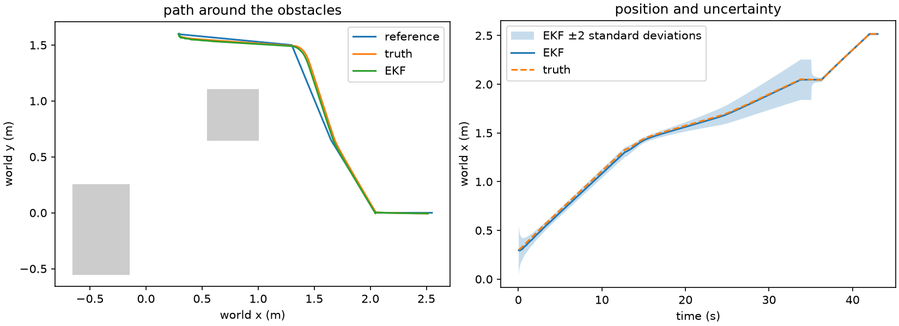
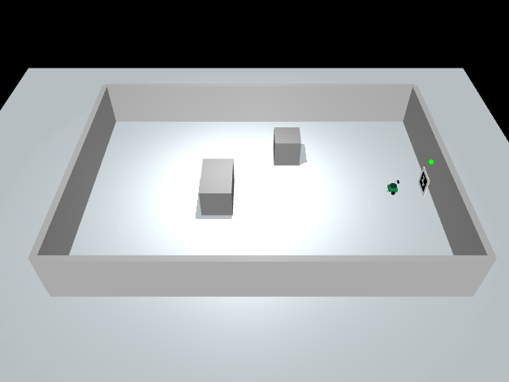

# fixed-route trial results

We ran these trials on 5 November 2026 using the repository's Python environment.
We use the true pose from MuJoCo to check how far the robot stopped from the dock and which way it was facing. Tracking RMSE compares the true path against the moving
reference. EKF RMSE compares the estimated position against truth.

| condition | success | charging | collision | time (s) | dock error (m) | heading error (deg) | tracking RMSE (m) | EKF RMSE (m) | wheel-only RMSE (m) |
|---|---|---|---|---:|---:|---:|---:|---:|---:|
| nominal | yes | yes | no | 43.45 | 0.03445 | 0.651 | 0.03749 | 0.01777 | 0.02788 |
| start heading +6° | yes | yes | no | 43.00 | 0.03459 | 0.601 | 0.03803 | 0.01691 | 0.01309 |
| heading gain 1.4 | yes | yes | no | 43.40 | 0.03505 | 0.559 | 0.03640 | 0.01764 | 0.02767 |
| camera corrections withheld during final approach | no | no | no | 120.00 | 0.50498 | 3.560 | 0.02398 | 0.01077 | 0.01877 |

The nominal and varied routes both stayed outside the inflated obstacle and
wall regions. The EKF improved position error on the nominal route, while
wheel-only odometry had lower RMSE on the varied route. These results are for the two starts we tried.

The lower heading gain reduced nominal tracking RMSE by about 1.1 mm. We
kept 1.8 as the default because we checked both starts with it. The camera-loss run stopped at the staging point and timed out
with the indicator off. that tracking RMSE includes the time spent waiting at staging.

| check | measured result |
|---|---|
| regression suite | 2 passed |
| camera pose at five stationary starts | all within 0.05 m and 3°. worst position error 0.0107 m and worst heading error 0.515° |
| encoder–camera EKF with one second of dropout | 40 accepted corrections. wheel-only RMSE 0.01002 m, EKF RMSE 0.00293 m. Covariance and angle wrapping checks passed |
| forward LiDAR facing east and north | 1.157 m and 2.957 m against 1.15 m and 2.95 m expected |
| actual obstacle in the forward sector | 0.225 m reading. The safety filter changed the forward command to zero |
| route sampled every 1 cm or closer | each sampled point passed the 0.22 m clearance check |

The older regression test expected a visible marker from the default spawn
and checked range and bearing. With the new room, the obstacle can block the camera at that start. The test now uses a visible manual start and checks the
full camera pose against truth.





Run these from the project folder to repeat the other checks.

```powershell
.\.venv\Scripts\python.exe -m turtlebot_project.simple_run --heading-gain 1.4 --output outputs/tuning
.\.venv\Scripts\python.exe -m turtlebot_project.simple_run --marker-loss
```

The five-minute demo with captions is at
`outputs/demo/TurtleBot_demo.mp4`. It includes both simulation runs, the
uncertainty plots and the green charging indicator.
